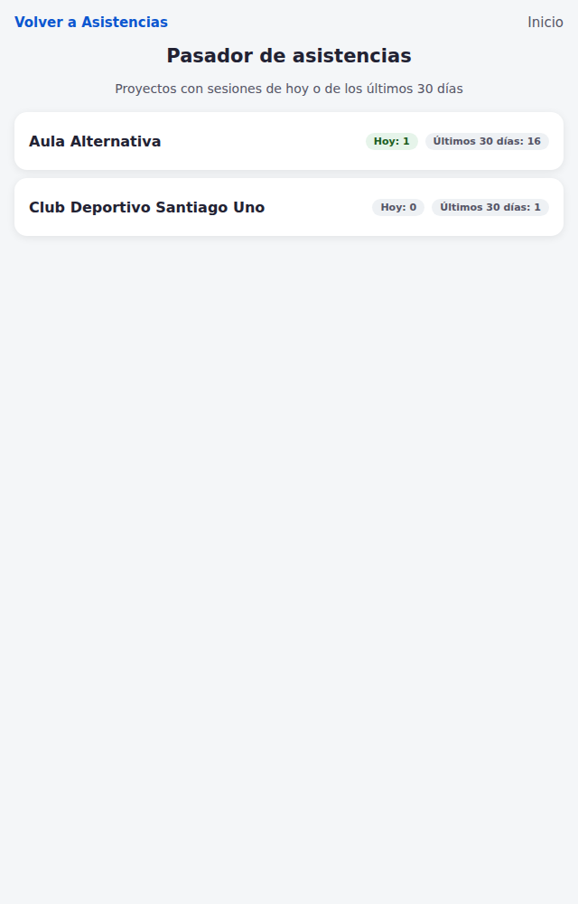
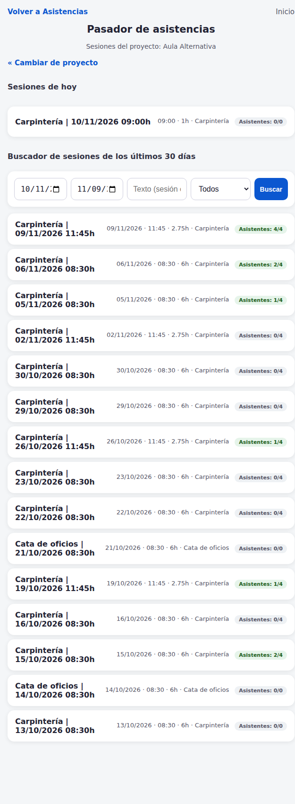
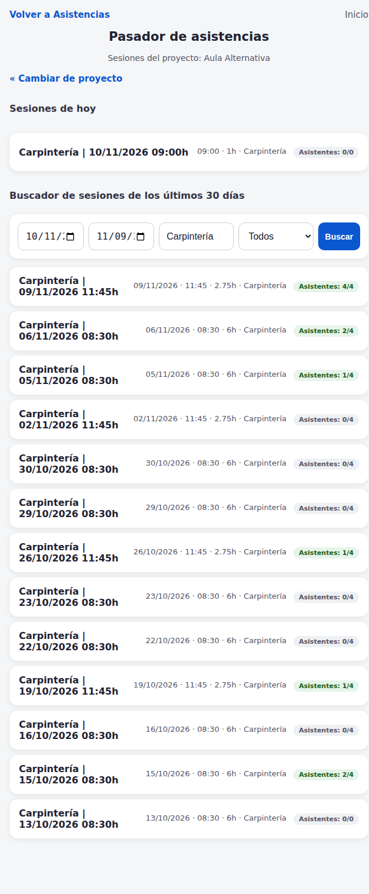
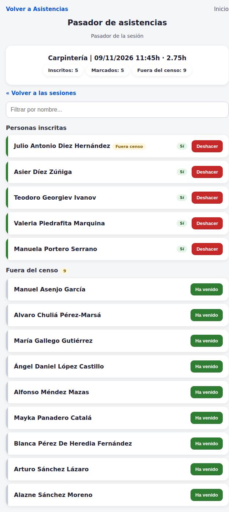
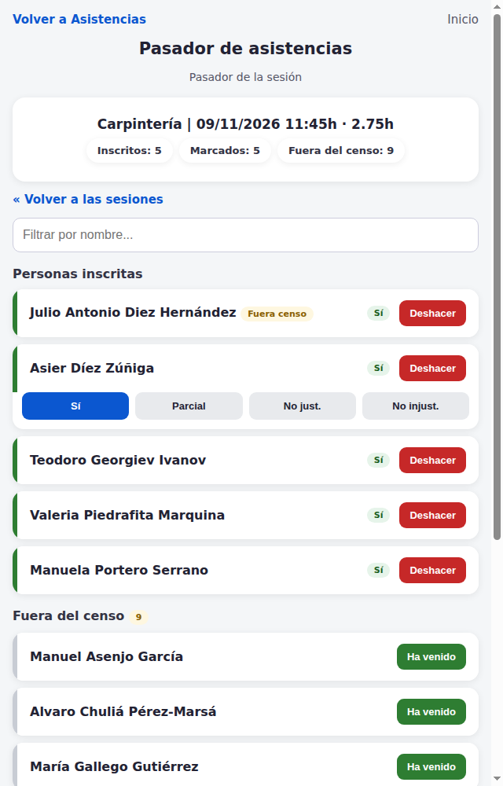
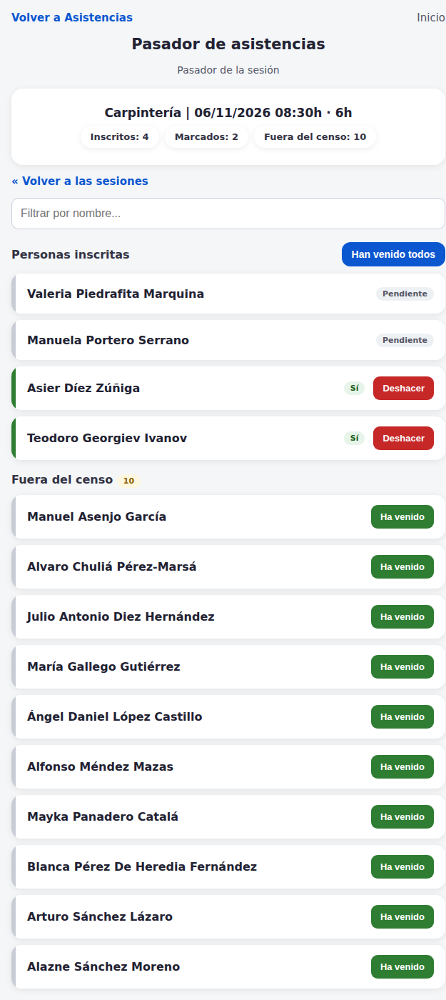
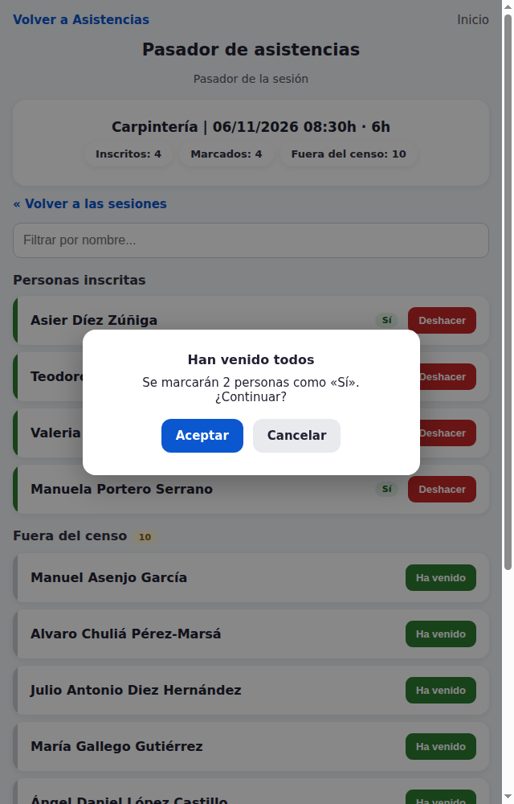
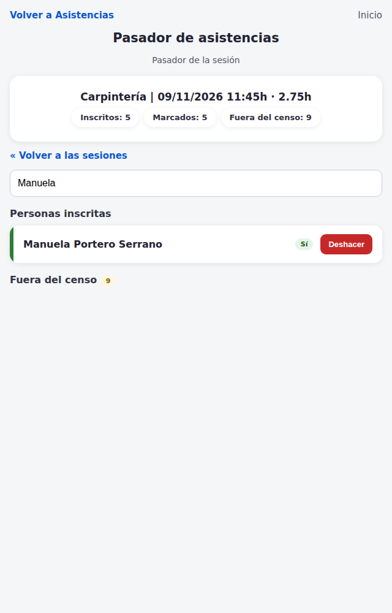
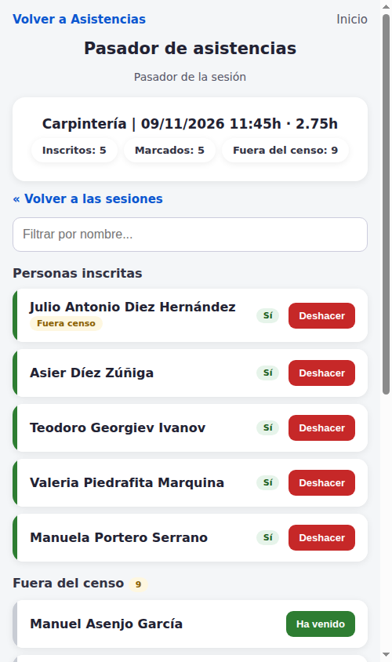
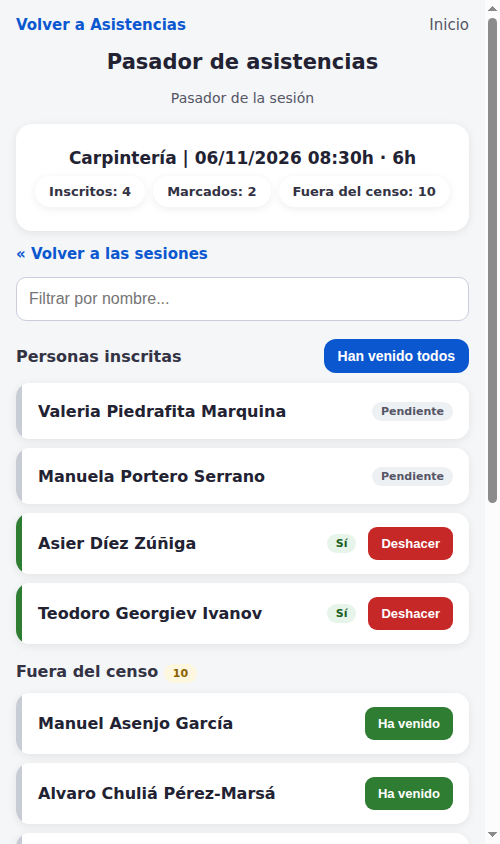

# Pasador de asistencias

**Manual de uso (versión de usuario)**

*Equipo AES · SinergiaTIC — v1.0 · noviembre 2026*

---

## 1. ¿Para qué sirve?

El **Pasador de asistencias** es la herramienta para *pasar lista* de una sesión (taller, casal, actividad...) directamente desde el móvil o la tablet, sin entrar en cada ficha del CRM.

Con ella puedes, con un solo toque:

- ✅ Marcar que una persona **ha venido**.
- ✏️ Corregir el estado (vino "Sí", vino "Parcial", no vino...).
- 👥 Marcar a **toda la gente de golpe** cuando el grupo completo ha asistido.
- ↩️ **Deshacer** cualquier marca si te equivocas.
- 📋 Apuntar a personas que **no estaban inscritas** de forma habitual ("fuera del censo").

Todos los cambios **se guardan al instante en el CRM**: aunque el dispositivo se apague o pierda la conexión, lo marcado hasta ese momento está a salvo. Y todo lo que hagas aquí se refleja también en las fichas normales del CRM (asistencias, horas, porcentajes).

---

## 2. ¿Cómo accedo?

Desde cualquier pantalla del CRM:

1. Abre el menú del módulo **Asistencias** (arriba a la izquierda, junto a "Crear").
2. Pulsa **«Pasador de asistencias»**.

> 💡 **Consejo**: si pasas lista a menudo, guarda la página en los favoritos del navegador o pide a tu administrador una "url amiga" para el dispositivo de sala. Si el CRM te pide usuario y contraseña, entra con tu usuario normal y te devolverá automáticamente al pasador.

---

## 3. Paso 1: escoge tu proyecto

Al entrar verás los **proyectos con actividad en curso**: los que tienen sesiones hoy o en los últimos 30 días.

- Cada proyecto muestra dos etiquetas: cuántas sesiones tiene **hoy** y cuántas ha tenido en los **últimos 30 días**.
- Toca tu proyecto (p. ej. *Aula Alternativa*).
- Si solo hay un proyecto con actividad, **entra directamente**: no hace falta elegir nada.
- Si te equivocas, más adelante siempre tendrás el enlace **«Cambiar de proyecto»** para volver.

---

## 4. Paso 2: las sesiones del proyecto

Verás dos bloques:

**A) «Sesiones de hoy»**: las sesiones programadas para HOY. En la etiqueta de la derecha verás *"Asistentes: 2/4"* → lleva marcadas 2 de las 4 personas inscritas.

**B) «Cercador... / Buscador de sesiones»**: si necesitas pasar lista o corregir una sesión de un día anterior, usa este buscador:

- Elige el rango de fechas (recuerda: nunca puede incluir el futuro).
- Escribe parte del nombre (**sesión o evento**) para encontrarla rápido.
- Pulsa **Buscar**.

- Los resultados van de la fecha más reciente a la más antigua.
- Toca la sesión que quieres y pasarás a pasar lista. Las sesiones **futuras no se dejan pasar lista** (aparecerán cuando llegue el día).

---

## 5. Paso 3: pasar lista

Esta es la pantalla de trabajo, pensada para usarse andando, con el móvil/la tablet en la mano.

### 5.1. Qué ves en la cabecera

- **Nombre de la sesión**, su hora y su duración.
- Tres contadores que se actualizan solos:
  - **Inscritos**: cuántas personas constan para esta sesión.
  - **Marcados**: cuántas llevan un estado ya puesto (ha venido, no ha venido...).
  - **Fuera del censo**: cuántas personas de la lista de abajo "extra" quedan por apuntar.

### 5.2. Marcar que alguien ha venido

1. Busca su nombre en la sección **«Personas inscritas»**.
2. **Toca una sola vez** sobre el nombre.

Hecho: la fila se pone **verde con «Sí»** y los contadores saltan. No hay que pulsar ningún botón de "Guardar".

> 💡 Los colores te orientan de un vistazo: **gris "Pendiente"** (falta marcarla), **verde "Sí"**, y los demás estados (vino parcialmente, no vino...) con su propia etiqueta.

### 5.3. Corregir el estado de una persona

1. Toca el **nombre** de una persona ya marcada.
2. Se abre una fila de botones con los estados disponibles:

3. Elige el estado correcto (**Sí / Parcial / No just. / No injust.**) y se guarda al instante.

### 5.4. Si ha venido todo el grupo

Si todos han asistido, no marques uno por uno. Esta captura muestra cómo se ve la lista con personas **pendientes** (gris / "Pendiente") y el botón **«Han venido todos»** en la parte superior derecha:

1. Pulsa el botón azul **«Han venido todos»** (encima de la lista, a la derecha).
2. Confirma en el aviso que aparece:

3. El sistema marca a las personas pendientes de golpe. Después, si alguien faltaba, basta tocar su nombre y corregir su estado (por ejemplo, "No just.").

> ⚠️ Este botón solo aparece cuando hay personas pendientes, y **no afecta a las personas "fuera del censo"** (esas siempre se apuntan una a una y a conciencia).

### 5.5. Si te equivocas: Deshacer

Cada fila marcada tiene un botón rojo **«Deshacer»**:

- Pulsas «Deshacer», confirmas en el aviso, y la persona vuelve a su estado anterior (aparece como "Pendiente").
- Si la habías apuntado de una lista "extra" ("fuera del censo"), al deshacerla desaparece su asistencia y **vuelve automáticamente a su lista de abajo**, lista para volver a apuntar si fuera un despiste o si necesitaras revisarlo.

### 5.6. Personas "fuera del censo"

Debajo de «Personas inscritas» puede aparecer la sección **«Fuera del censo»** con un contador:

Son personas vinculadas a la actividad que **no constan como inscritas de forma regular** (por ejemplo, gente en lista de espera, personas incorporadas de última hora o invitaciones puntuales, según lo trabaje cada entidad).

- Toca **«Ha venido»** en su fila y se le crea la asistencia como "Sí".
- La persona aparecerá entonces arriba, dentro de "Personas inscritas", con una insígnia amarilla **«Fuera cens»** que indica su origen.
- **Importante**: apuntar a esta gente **no cambia su situación de inscripción en el CRM**; solo crea la asistencia del día. Por eso no se marca en bloque: cada "Ha venido" es consciente e individual.
- Si te equivocas, usa su **«Deshacer»** y volverá a su lista.

### 5.7. Encontrar a alguien en una lista larga

En las sesiones con mucha gente, usa el cuadro **«Filtrar por nombre...»** de la parte superior: escribe unas letras del nombre o apellido y la lista se reduce solo a las coincidencias (tolera tildes y mayúsculas). Borra el texto para ver la lista completa de nuevo.

### 5.8. ¿Y si la lista cambia mientras pasas lista?

No pasa nada: la lista **se refresca sola** después de cada acción. Y si otra persona del equipo está en la misma sesión a la vez desde otro dispositivo, cada toque se guarda por separado sin pisarse.

---

## 6. En el móvil o la tablet

El pasador está pensado **para el bolsillo**: listas grandes, botones de toque generoso y sin menús enrollados.

> 💡 En la tablet, si el pasador "pierde la sesión" del CRM (te pide de nuevo usuario y contraseña), entra y volverás a la misma pantalla donde estabas.

---

## 7. Preguntas frecuentes

**¿Tengo que pulsar "Guardar" en algún momento?**
No. Cada toque se guarda inmediatamente. Los contadores de la cabecera te confirman que el CRM lo ha registrado.

**¿Puedo pasar lista de una sesión futura?**
No. Las sesiones aún no celebradas no aparecen para pasar lista (aparecerán el día de la sesión o en el buscador cuando hayan pasado).

**¿Puedo pasar lista de una sesión que fue hace días?**
Sí, desde el buscador (máximo dentro de la ventana de días que tenga configurada la entidad; por defecto 30).

**Al apuntar a una persona "fuera del censo", ¿cambia su inscripción?**
No. La persona se mantiene exactamente donde estaba en el CRM; únicamente se crea la asistencia de esa sesión.

**¿Dónde veo luego todo lo marcado?**
En el propio módulo **Asistencias** del CRM, en la ficha de la sesión y de cada persona, tal como lo harías siempre.

**He marcado a alguien sin querer, ¿qué hago?**
Pulsa **«Deshacer»** en su fila. Si era de las inscritas, vuelve a "Pendiente"; si era de "fuera del censo", desaparece su asistencia y vuelve a su lista inferior.

---

## 8. Buenas prácticas

1. **Pasa lista al empezar la sesión** y corrige los cambios (tardanzas, marchas tempranas) al acabar: así los datos del CRM quedan limpios.
2. Usa el **buscador por nombre** para no marcar a la persona equivocada cuando hay nombres parecidos.
3. Los **estados** (Parcial, No just., No injust.) tienen el mismo significado que en las asistencias del CRM; úsalos igual que con la herramienta clásica.
4. Si detectas que faltan personas o datos raros (nombres duplicados, gente que no está en la actividad...), el problema estará en las **inscripciones del CRM** — avisa a tu responsable del CRM, no intentes "arreglarlo" desde el pasador.
5. Cambia de dispositivo sin miedo: lo marcado ya está guardado.

---

*Documentación técnica de la adaptación: IMPL-AAES-001 (equipo AES). Para incidencias, contacta con el equipo de CRM de tu entidad o con SinergiaTIC.*
