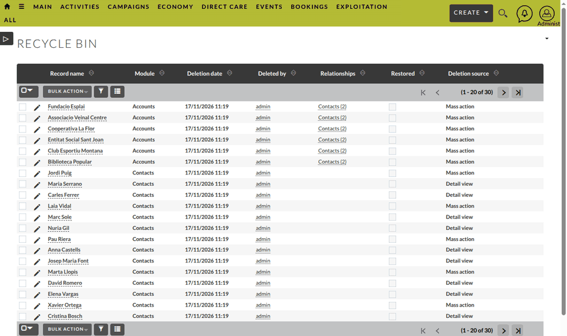

# Recupera el que hàs eliminat: la paperera de reciclatge de SinergiaCRM

**Tag:** destacat · **Categoria:** Notícies · **Idioma:** Català

---

Eliminar un registre per error ja no és definitiu. SinergiaCRM incorpora la **paperera de reciclatge**, una nova funcionalitat que guarda tots els registres esborrats de qualsevol mòdul i permet recuperar-los —juntament amb les seves relacions— en qualsevol moment.

## Què fa, en poques paraules

- **Registra cada eliminació:** mòdul, nom, data, usuari que ho va fer i l'origen (vista de detall, acció massiva, combinació de duplicats o acció externa).
- **Conserva les relacions** que tenia el registre en el moment de suprimir-lo.
- **Recupera un o diversos registres** a la vegada des de la vista de llista, amb un sol clic i confirmació.
- **Reactiva les relacions** (molts a molts i un a molts) i indica quantes s'han restaurat i quantes s'han omès perquè el registre relacionat ja no existeix.
- **Conservació de 90 dies:** passat aquest termini, una tasca programada esborra definitivament els registres i les seves entrades a la paperera.

Només cal anar a **Administració > SinergiaCRM > Paperera de reciclatge**, obrir l'entrada i prémer **Restaurar**. Si l'eliminació va procedir d'una combinació de duplicats, la fitxa mostra un avís i un enllaç al registre conservat per revisar les relacions manualment.

## Demostració

*Vídeo complet: [papelera_demo.mp4](papelera_demo.mp4)*

## Més informació

Consulta el manual complet a la wiki: [Papelera de reciclaje](https://wiki.sinergiatic.org/index.php/Papelera_de_reciclaje)
